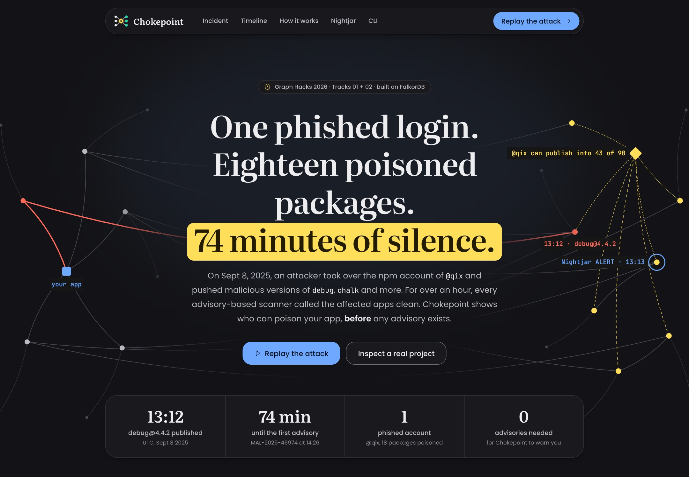
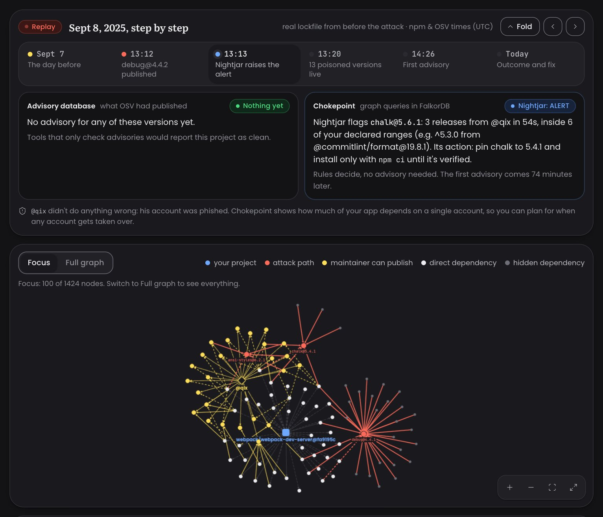
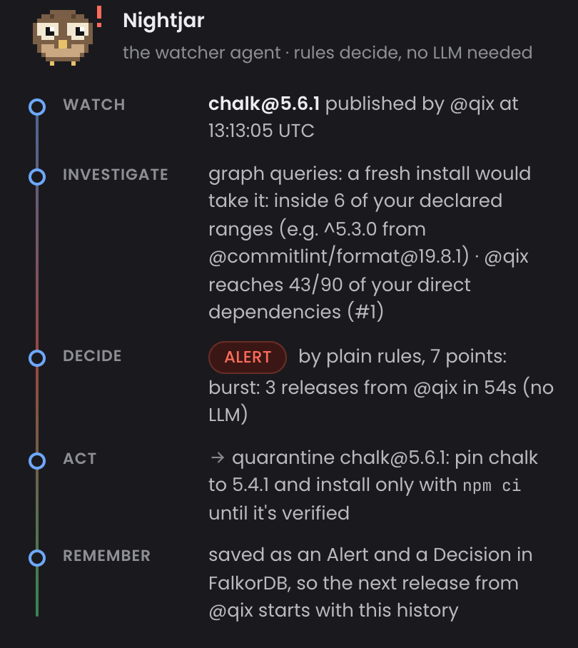
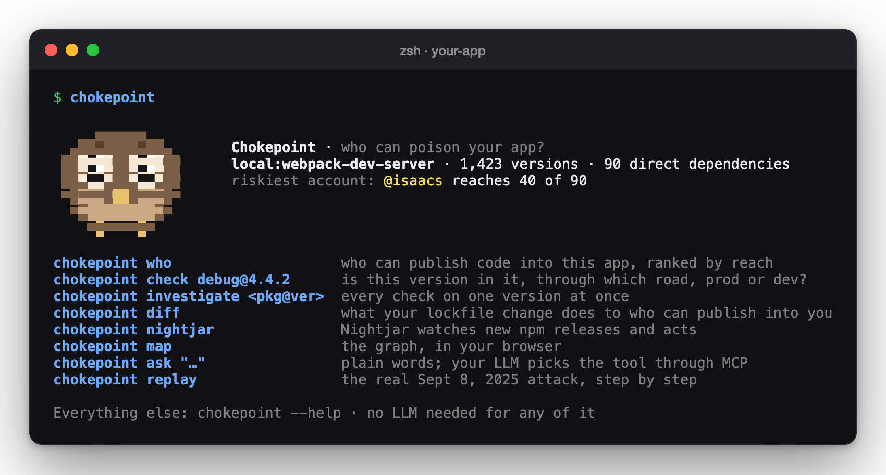
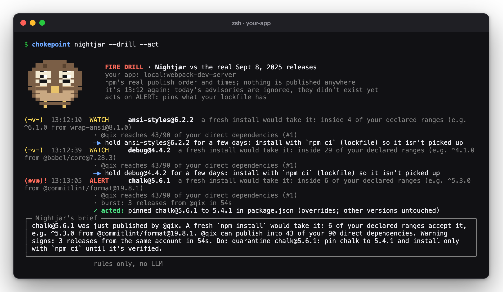
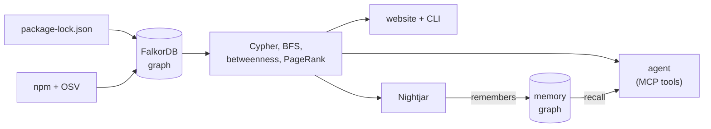

<p align="center">
  
</p>

<h1 align="center">Chokepoint</h1>

<p align="center">
  <b>Who can poison your app?</b><br>
  <sub>Chokepoint maps every npm account that can push code into your project.<br>
  Its watcher agent, <b>Nightjar</b>, speaks up before the security advisory does.</sub>
</p>

<p align="center">
  <a href="https://drive.google.com/file/d/1DY8HlSAMpVTsf3D6Liw6TRd3d2U3ecUC/view?usp=sharing"></a>
  <a href="https://youtu.be/tDuUKNMRDRw"></a>
  <a href="https://chokepoint.onrender.com"></a>
  <a href="cli/README.md"></a>
</p>

<p align="center">
  
  <a href="https://www.falkordb.com/"></a>
  <a href="https://pypi.org/project/ckpoint/"></a>
  <a href="https://github.com/laypatel13/chokepoint/actions/workflows/ci.yml"></a>
  
  <a href="LICENSE"></a>
</p>

<div align="center"><table><tr><td></td></tr></table></div>

<p align="center">
  <a href="#the-story-in-30-seconds">The story</a> ·
  <a href="#see-what-happened">See what happened</a> ·
  <a href="#protect-your-app">Protect your app</a> ·
  <a href="#why-a-graph">Why a graph</a> ·
  <a href="#for-the-judges-how-it-maps-to-the-tracks">For the judges</a> ·
  <a href="#graph-model-and-queries">Graph model</a> ·
  <a href="#run-it-yourself">Run it yourself</a>
</p>

<br>

## The story in 30 seconds

On **Sept 8, 2025**, someone phished the npm login of one well-known maintainer, `@qix`. Within minutes they
pushed poisoned versions of **18 hugely popular packages**, including `debug` and `chalk`, which sit inside
millions of apps.

The first public warning, an OSV advisory, appeared **74 minutes later**. Until then, every scanner that works
from advisories said *"all clear"*.

> [!IMPORTANT]
> The danger wasn't one package. It was **one person's account**. A graph of *packages* and *the people who can
> publish them* could have shown that the day before, and that graph is what Chokepoint builds.

<table>
  <tr>
    <td align="center" width="25%"><b>13:12</b><br><sub>the first poisoned<br>version is published</sub></td>
    <td align="center" width="25%"><b>13:13</b><br><sub>Nightjar would have<br>raised its ALERT</sub></td>
    <td align="center" width="25%"><b>14:26</b><br><sub>the first advisory<br>appears at OSV</sub></td>
    <td align="center" width="25%"><b>74 min</b><br><sub>of "all clear"<br>from scanners</sub></td>
  </tr>
</table>

<br>

## See what happened

**The real attack, replayed on real data:** webpack-dev-server's lockfile from two weeks before, npm's real
publish times and OSV's real advisory times. Nothing is simulated, and nothing in the replay touches your own
projects.

<table>
  <tr>
    <td width="50%" valign="top">
      <h4>In your browser</h4>
      Open <a href="https://chokepoint.onrender.com"><b>chokepoint.onrender.com</b></a>, press <b>Replay the attack</b>
      and step through the day, moment by moment. At the end the fix opens a <b>real pull request</b> on
      <a href="https://github.com/laypatel13/webpack-dev-server/pull/1">our sandbox fork</a>, and Nightjar leaves a note
      there for your visit.
    </td>
    <td width="50%" valign="top">
      <h4>In your terminal</h4>
      Install the CLI, then replay the attack from any folder: <code>chokepoint replay</code>.
      <code>replay who</code>, <code>replay check debug@4.4.2</code> and <code>replay nightjar --live</code> walk
      through it. Every replay command is in the <a href="cli/README.md#1-see-what-happened-the-sept-8-replay">CLI
      guide</a>.
    </td>
  </tr>
</table>

#### 13:13, side by side

<div align="center"><table><tr><td></td></tr></table></div>

On the left, what an advisory-based tool knew at 13:13: **nothing**. On the right, what the graph and Nightjar
knew: `chalk@5.6.1` is the **third release from `@qix` in 54 seconds**, and the app would take it. Below, the
graph lights up who can publish into the app (yellow) and the poisoned versions it would pull in (red).

<div align="center"><table><tr><td></td></tr></table></div>
<p align="center"><sub>Nightjar's whole decision, from the real data: <b>watch → investigate → decide → act → remember</b>.</sub></p>

<br>

## Protect your app

The real product runs on **your** machine, on **your** app: no account, no limits, and nothing leaves your
laptop. No AI is needed either: the graph gives every answer.

**1 · Install** (the package is `ckpoint`; the command is `chokepoint`):

```sh
pipx install --python 3.12 ckpoint
```

**2 · Say hello** from your app's folder. Chokepoint finds your `package-lock.json` and builds the graph:

```sh
chokepoint
```

<div align="center"><table><tr><td></td></tr></table></div>

**3 · Ask the questions that matter.**

<table>
  <tr>
    <th width="34%">Question</th>
    <th>What Chokepoint answers</th>
  </tr>
  <tr>
    <td><b>Who can poison my app?</b><br><code>chokepoint who</code></td>
    <td>Every npm account, ranked by how much of your app it can reach: <i>"<code>@qix</code> can publish into 43 of your 90
      direct dependencies."</i> Teams, bots and long-quiet accounts are marked.</td>
  </tr>
  <tr>
    <td><b>How did this version get in?</b><br><code>chokepoint check debug@4.4.2</code></td>
    <td>The exact road into your app (<code>your-app → spdy → debug</code>), and whether it ships to production or
      only to your dev tools.</td>
  </tr>
  <tr>
    <td><b>Did my lockfile save me?</b><br><code>chokepoint saved debug@4.4.2</code></td>
    <td>Whether a fresh <code>npm install</code> would have pulled the bad version, and which of your version ranges
      would let it in.</td>
  </tr>
  <tr>
    <td><b>What do I change?</b><br><code>chokepoint fix debug@4.4.2</code></td>
    <td>The newest clean version that fits every range, as a precise <code>overrides</code> entry.<br>
      <code>--write</code> adds it · <code>--pr</code> opens a pull request on your repo.</td>
  </tr>
  <tr>
    <td><b>Who watches while I sleep?</b><br><code>chokepoint nightjar</code></td>
    <td><b>Nightjar</b>, below.</td>
  </tr>
</table>

### Meet Nightjar

<p align="center"></p>

A nightjar is a night bird with huge eyes that hides in plain sight until it moves. Ours watches npm: every
minute it checks for new releases of your app's packages, investigates each one in the graph, **decides by plain
rules**, acts, and remembers.

| Face | Level | What it means |
|:---:|---|---|
| `(●v●)` | **watching** | New releases are coming in; nothing worrying. |
| `(¬v¬)` | **WATCH** | A release your app could pick up: hold it for a few days. |
| `(◉v◉)!` | **ALERT** | A risky pattern, like one account publishing again and again: it pins the version you have. |
| `(^v^)` | **calm** | Nothing flagged, or the danger has passed. |
| `(-v-)ᶻ` | **resting** | Not watching right now. |

On an ALERT it can pin the version you already have (only the poisoned one), open a fix PR on **your** repo with
**your** token, notify you on the desktop or in Slack and Discord, and remember the account for next time.

**See it work right now** with a fire drill: the real Sept 8 releases, fed into Nightjar's live loop against
*your* app. Nothing is published anywhere:

```sh
chokepoint nightjar --drill --act
```

<div align="center"><table><tr><td></td></tr></table></div>

**Guard your pull requests** in CI. This fails a PR that lets a far-reaching new npm account into your app:

```sh
chokepoint diff origin/main --fail-on risky
```

> [!TIP]
> Every command, the AI helper (optional, your own model or key), fix PRs on your repo, Slack alerts and CI
> options are in the **[CLI guide](cli/README.md)**.

<br>

## Why a graph

*"Who can poison me?"* joins **people** to **everything downstream of everything you depend on**. That's a walk
through thousands of links, and in a graph database it's one query. Take FalkorDB out and the question can't be
answered at all: no advisory database knows the answer, because the answer is the *shape* of your dependencies.



#### By the numbers

Measured on the live graph.

| Project | Versions | Direct dependencies | npm accounts | Links | Advisories |
|---|--:|--:|--:|--:|--:|
| **webpack-dev-server**, Aug 25 2025 *(the replay)* | 1,423 | 90 *(29 prod)* | 685 | 3,108 | 155 |
| webpack-dev-server today | 1,128 | 76 *(26 prod)* | 594 | 2,491 | 8 |
| mocha today | 715 | 53 *(16 prod)* | 447 | 1,256 | 39 |

<br>

## For the judges: how it maps to the tracks

<table>
  <tr><th colspan="2" align="left">Track 01 · Agents That Act on Connected Data</th></tr>
  <tr>
    <td width="30%"><b>Multi-hop reasoning</b></td>
    <td>Attack paths and reach across thousands of links: from your app, through every hidden dependency, to the
      people who can publish them. <a href="backend/graph/queries.py"><code>queries.py</code></a></td>
  </tr>
  <tr>
    <td><b>Graph queries and algorithms as agent tools</b></td>
    <td>Every tool is a Cypher query or a FalkorDB algorithm (<code>algo.BFS</code>, <code>algo.betweenness</code>,
      <code>algo.pageRank</code>), defined once in <a href="backend/tools.py"><code>tools.py</code></a> and served by
      the <a href="backend/mcp_server.py">MCP server</a>.</td>
  </tr>
  <tr>
    <td><b>Tool selection through MCP</b></td>
    <td>The <code>ask</code> agent is an MCP client of Chokepoint's own MCP server: the LLM picks a tool, the graph
      answers (keyword rules without an LLM). <a href="backend/agent/mcp_agent.py"><code>mcp_agent.py</code></a></td>
  </tr>
  <tr>
    <td><b>Actions based on what the graph shows</b></td>
    <td>Nightjar pins the poisoned version and opens fix PRs; the website opened a
      <a href="https://github.com/laypatel13/webpack-dev-server/pull/1">real one</a>.
      <a href="backend/watch/agent.py"><code>watch/agent.py</code></a> ·
      <a href="backend/actions/github_pr.py"><code>github_pr.py</code></a></td>
  </tr>
  <tr>
    <td><b>Explainable results</b></td>
    <td>Every answer shows the Cypher that ran (<i>Cypher that ran</i> in the app, <code>--explain</code> in the CLI);
      every Nightjar decision is a list of plain, checkable reasons.
      <a href="backend/watch/signals.py"><code>signals.py</code></a></td>
  </tr>
  <tr><th colspan="2" align="left">Track 02 · Agent Memory and Coordination</th></tr>
  <tr>
    <td><b>Memory that persists</b></td>
    <td>A FalkorDB graph per project (<code>memory:&lt;project&gt;</code>) that survives restarts and re-scans.
      <a href="backend/watch/memory.py"><code>memory.py</code></a></td>
  </tr>
  <tr>
    <td><b>Memory that updates over time</b></td>
    <td>Open alerts are re-checked against OSV every cycle and move to <b>CONFIRMED</b> or <b>CLEARED</b>; every move
      is a new <code>Decision</code>, so the history stays.</td>
  </tr>
  <tr>
    <td><b>Shared between agents</b></td>
    <td>Nightjar writes it; the <code>ask</code> agent reads it through the MCP <code>recall</code> tool. Earlier
      alerts on an account also raise the score of its next release.</td>
  </tr>
  <tr>
    <td><b>Separate memory per tenant</b></td>
    <td>One memory graph per project; fire-drill and replay notes are flagged and never count as real history.</td>
  </tr>
</table>

<br>

## Graph model and queries

### Graph model

One FalkorDB graph per project (`repo:<owner>/<name>`), so algorithms run on just that project. Nightjar's
memory lives in its own graph per project (`memory:<project>`), so rebuilding a project never erases it.

```
(Project)-[:DEPENDS_ON {range, dev}]->(Version)        a direct dependency
(Version)-[:DEPENDS_ON {range}]->(Version)             resolved from the lockfile (Node's lookup rule)
(Version)-[:VERSION_OF]->(Package)
(Maintainer)-[:MAINTAINS {current, at_install}]->(Package)   who can publish it, today and at install time
(Maintainer)-[:PUBLISHED]->(Version)                   who actually pushed this version
(Advisory)-[:AFFECTS]->(Version)                       from OSV

Nightjar's memory:  (Alert)-[:ABOUT]->(Package)   (Alert)-[:PUBLISHED_BY]->(Maintainer)
                    (Decision)-[:BASED_ON]->(Alert)
```

| Label | Key | Kept |
|---|---|---|
| `Project` | `repo` | name, scan time, lockfile version, replay flag |
| `Version` | `name@version` | dev-only flag, publish time |
| `Package` | `name` | latest version |
| `Maintainer` | npm `username` | last release date. **Never emails**: they're dropped when read |
| `Advisory` | `id` | aliases, summary, malware or vulnerability, publish time, severity |

### The queries

All Cypher lives in [`backend/graph/queries.py`](backend/graph/queries.py): parameterised (never built from
user input), each with a plain-English comment. The main ones:

| Query | Answers |
|---|---|
| `SHORTEST_PATHS`, `SHORTEST_FROM_DIRECT` | the road from your app to a version, preferring production |
| `DIRECT_DEPS_REACHING` | which of your direct dependencies pull a version in (`algo.BFS`) |
| `DEPENDENTS_COUNT` | how many installed versions depend on it: one walk backwards from that version, each counted once |
| `CHOKEPOINT_REACH` | for every account: how many direct dependencies reach a package it can publish (`algo.BFS`) |
| `CHOKEPOINT_BETWEENNESS` | which accounts sit on the bridges many paths pass through (`algo.betweenness`, fixed seed) |
| `CHOKEPOINT_PAGERANK` | how influential the versions an account controls are (`algo.pageRank`) |
| `MAINTAINER_FOOTPRINT` | everything one account touches, for the yellow highlight |
| `RANGES_FOR_PACKAGE`, `RANGES_INTO_VERSION` | your declared ranges vs what the lockfile pins ("did my lockfile save me?") |
| `MAINTAINERS_LAST_PUBLISHED` | quiet accounts that can still publish ("quiet since 2015") |
| `MEM_RECALL`, `MEM_ACCOUNT_HISTORY`, … | Nightjar's memory |

> [!NOTE]
> **Why BFS and not `[:DEPENDS_ON*]`?** A variable-length pattern walks every possible *path*, and real
> dependency graphs have exponentially many: the naive reach query (from every dependency, to everything) timed
> out. `algo.BFS` visits each node once. Counting what depends on *one* version is the exception: a single walk
> backwards from it with `count(DISTINCT …)` is about 10× faster than a BFS from every node, with the same count.

### Scoring "who could poison me?"

For each npm account, in order:

1. **Reach**: how many of your direct dependencies pull in at least one package it can publish
   (or production dependencies first, with `--prod` / "Prod first").
2. **Bridges**: the betweenness of the versions it controls (tie-breaker).
3. **Influence**: their PageRank (tie-breaker).

Around the ranking: "Together, the top 3 reach 64 of 90". Teams that publish exactly the same packages are
shown as one row ("+65 tied"), automated accounts get a **bot** badge, and accounts that can still publish
but haven't in years are marked **quiet since …**.

### Nightjar's rules

Each new release gets points for plain, checkable signals:

| Signal | Points |
|---|:---:|
| A fresh install would take it (inside your declared ranges) | +3 |
| A burst: 3 or more releases from one account within 10 minutes | +3 |
| A new install script (`preinstall`, `install`, `postinstall`) | +3 |
| The publisher isn't in the package's maintainer list (trusted publishing from the package's own CI is recognised) | +3 |
| Provenance dropped, though the previous version had it | +2 |
| The publisher reaches much of your app (top 10, or 20%+ of direct dependencies) | +1 |
| The account already triggered alerts (memory) | +1 |

Inside your ranges, **3 points** is a **WATCH** and **6** an **ALERT**; an OSV malware advisory makes it
**CONFIRMED**. On Sept 8, `chalk@5.6.1` scored 7: inside 6 ranges (+3), the third release in 54 seconds (+3),
from an account reaching 43 of 90 dependencies (+1). An LLM, if you have one, may investigate an ALERT with up
to three read-only tools and write the brief. **It never changes the verdict.**

### Memory that agents share

Nightjar's memory is a FalkorDB graph of its own per project (`memory:<project>`), next to the project's graph:

- **It lasts.** Alerts and decisions survive restarts and re-scans: rebuilding a project's graph never touches
  its memory.
- **It changes as the world does.** An open alert is re-checked against OSV on every cycle: a malware advisory
  moves it to **CONFIRMED**; none after the cooldown moves it to **CLEARED**. Every move is a new `Decision`
  linked to the alert, so the history stays.
- **It feeds the next decision.** Earlier alerts on the same npm account raise the score of its next release
  (`MEM_ACCOUNT_HISTORY`).
- **Two agents share it.** Nightjar writes it; the `ask` agent reads it through the MCP `recall` tool, so
  "what did Nightjar see?" is answered from the same graph, in the terminal, the app or any MCP client.
- **Kept apart.** One memory graph per project, and fire-drill or replay notes are marked as such, so they never
  count as real history.

The memory queries (`MEM_SAVE_ALERT`, `MEM_SAVE_DECISION`, `MEM_RECALL`, `MEM_ACCOUNT_HISTORY`,
`MEM_OPEN_ALERTS`, …) are in [`backend/graph/queries.py`](backend/graph/queries.py) with the rest.

<br>

## Run it yourself

### With Docker

This runs the website, FalkorDB and every loaded project. First, copy the settings file (optional: add an LLM,
and a GitHub token for the PR button):

```sh
cp .env.example .env
```

Start everything. It loads the projects on start, which takes about a minute the first time:

```sh
docker compose up --build
```

Then open [localhost:8000](http://localhost:8000) for the story page (the app is at `/app`). To check that both
main questions work end to end:

```sh
python backend/scripts/verify.py
```

### For development

Start the graph database:

```sh
docker compose up -d falkordb
```

Create a Python 3.12 environment and install Chokepoint into it:

```sh
uv venv -p 3.12 .venv && uv pip install -e '.[dev]'
```

Load the projects into the graph (about 50 seconds the first time, a few seconds after that):

```sh
.venv/bin/python backend/scripts/seed.py
```

Build the website into the Python package:

```sh
cd frontend && npm ci && npm run build && cd ..
```

Start the server on [localhost:8000](http://localhost:8000):

```sh
.venv/bin/uvicorn chokepoint.api.app:app --port 8000
```

### Tests

Python:

```sh
.venv/bin/pytest
```

Types, lint and unit tests for the website (inside `frontend/`):

```sh
npm run check
```

Browser tests in real Chrome, for both the website and `chokepoint map` (inside `frontend/`):

```sh
npm run e2e
```

All three run on every push in [CI](https://github.com/laypatel13/chokepoint/actions/workflows/ci.yml).

### Settings (`.env`)

| Variable | What it's for |
|---|---|
| `FALKORDB_HOST`, `FALKORDB_PORT` | the graph database (`FALKORDB_USERNAME`, `FALKORDB_PASSWORD` for FalkorDB Cloud) |
| `LLM_BASE_URL`, `LLM_API_KEY`, `LLM_MODEL` | any OpenAI-compatible LLM (Ollama, Groq, Gemini, …). Leave empty: everything still works |
| `LLM_REASONING_EFFORT` | `none` turns off "thinking" on local models (faster). Leave empty for hosted ones |
| `GITHUB_TOKEN`, `GITHUB_DEMO_REPO` | the website's PR button: a fine-grained token for **one sandbox fork only** |

### Where things are

| Folder | What's inside | Start reading at |
|---|---|---|
| `backend/` | the Python package: lockfile reading, the FalkorDB graph, the tools, the agent, Nightjar, the website's API, the MCP server | `backend/tools.py`, `backend/graph/queries.py` |
| `cli/` | the `chokepoint` command line | [`cli/README.md`](cli/README.md) |
| `frontend/` | the website and the app (React + Vite), built into `backend/web/` | `frontend/src/app/useChokepoint.ts` |

<br>

## Safety and privacy

- **Usernames only.** Chokepoint stores npm usernames, never emails or anything personal.
- **No accounts, cookies, analytics or trackers.** Scans on the website are public (the site says so before you
  scan, and `chokepoint share` asks first). Everything is in the
  **[privacy notice](https://chokepoint.onrender.com/privacy)**.
- **Your code stays home.** The CLI reads your lockfile locally; only package names go to npm and OSV.
- **Your keys stay yours.** Your AI key and GitHub token live in your system keychain and go only to their own
  service, only encrypted. Never printed, never logged, never sent to Chokepoint's website.
- **No AI required.** Without an LLM everything works; with one, it only picks tools and rewords results. It
  never writes or runs a database query, and never changes a verdict.
- **Fixes never merge themselves.** PRs need your token (one repo, fine-grained), and a person merges them.
- **The public website defends itself**: per-visitor limits, global caps and size limits. Its PR button
  works only on a sandbox fork, only for the 18 packages poisoned on Sept 8, and every word on GitHub
  (the PR, and Nightjar's note for each visit) is written by the server: nothing a visitor types gets there.
  Details in [`backend/api/limits.py`](backend/api/limits.py).

> [!NOTE]
> **Honest limits.** npm only (`package-lock.json` v2/v3, not yarn or pnpm yet). Chokepoint flags risky releases
> early; it doesn't detect malware by reading code, and an advisory confirms that later. npm doesn't publish who
> could publish a package in the past, so "at install time" uses each version's own maintainer snapshot.

## Built with

[FalkorDB](https://www.falkordb.com/) (the graph, with its BFS, betweenness and PageRank), Python, FastAPI,
the MCP SDK, React, Vite, Cytoscape.js and GSAP. Data from the npm registry and [OSV](https://osv.dev).

**AI usage, honestly:** built with Claude Code (Anthropic) as a coding assistant, under close supervision: the
scaffolding, the lockfile parser, Cypher drafts, the UI and tests. Every query was run and checked by hand in
FalkorDB. At runtime an LLM is optional and only picks tools and rewords their output.

## License

MIT, see [LICENSE](LICENSE).

<br>

<p align="center">
  <br>
  <sub><i>Watches from the shadows. Speaks up before the advisory does.</i></sub>
</p>
